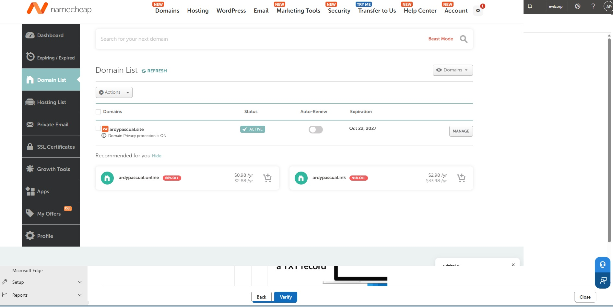

# Custom Domain Migration: From `evilcorpLAB.onmicrosoft.com` to `ardypascual.site`

**Hybrid Identity Lab | Namecheap → Microsoft 365 → Entra ID → On-Prem Active Directory**

In this lab I bought a real domain (`ardypascual.site`) and replaced the default `evilcorpLAB.onmicrosoft.com` tenant domain with it. I then pushed the change all the way down to my on-premises Active Directory (EvilCorp.com on Windows Server 2025) so users sign in with `user@ardypascual.site` and receive email on the new domain.

> Moving a domain in a hybrid environment is not just a DNS task. The **on-prem UPN suffix** and the **user UPNs** must also change, or Entra ID keeps showing the old `onmicrosoft.com` name after sync.

---

## Table of Contents

1. [Lab Environment](#1-lab-environment)
2. [Workflow Overview](#2-workflow-overview)
3. [Step 1: Buy the Domain on Namecheap](#step-1-buy-the-domain-on-namecheap)
4. [Step 2: Add the Domain in Microsoft 365 and Get the DNS Records](#step-2-add-the-domain-in-microsoft-365-and-get-the-dns-records)
5. [Step 3: Configure DNS in Namecheap (TXT, MX, CNAME)](#step-3-configure-dns-in-namecheap-txt-mx-cname)
6. [Step 4: Finish Domain Setup in Microsoft 365](#step-4-finish-domain-setup-in-microsoft-365)
7. [Step 5: Verify the New Primary Domain in Entra ID](#step-5-verify-the-new-primary-domain-in-entra-id)
8. [Step 6: Add the UPN Suffix On-Prem](#step-6-add-the-upn-suffix-on-prem)
9. [Step 7: Update User UPNs (Admin Account and Batch)](#step-7-update-user-upns-admin-account-and-batch)
10. [Step 8: Confirm the Mailbox Uses the New Domain](#step-8-confirm-the-mailbox-uses-the-new-domain)
11. [Troubleshooting Notes](#troubleshooting-notes)
12. [Key Takeaways](#key-takeaways)

---

## 1. Lab Environment

| Component | Details |
|---|---|
| Hypervisor host | Windows 11 Pro running Hyper-V (`ARDYWIN11PC`) |
| Domain Controller | `DC-SERVER2026`, Windows Server 2025, domain `EvilCorp.com` |
| Cloud tenant | Microsoft 365 / Microsoft Entra ID (`evilcorpLAB.onmicrosoft.com`) |
| Sync | Microsoft Entra Connect (Azure AD Connect) |
| Registrar / DNS host | Namecheap |
| New domain | `ardypascual.site` |

---

## 2. Workflow Overview

```
Buy domain (Namecheap)
        │
        ▼
Add domain in Microsoft 365 admin center ──► Verify with TXT record
        │
        ▼
Add MX + CNAME (autodiscover) + TXT (SPF) in Namecheap
        │
        ▼
Domain setup complete ──► Entra ID shows new primary domain
        │
        ▼
On-prem AD: add UPN suffix ──► change user UPNs (single + batch)
        │
        ▼
Entra Connect sync ──► users and mailbox use @ardypascual.site
```

---

## Step 1: Buy the Domain on Namecheap

I registered **ardypascual.site** on Namecheap. In the Domain List the domain shows as **Active**, with Domain Privacy protection **ON**. Expiry is **Oct 22, 2027** (1-year registration) and **Auto-Renew is off**, so I need to renew it manually if I want to keep it.



*Namecheap Domain List: `ardypascual.site` is Active. Behind the page you can see the Microsoft 365 "Verify" step waiting for the TXT record.*

---

## Step 2: Add the Domain in Microsoft 365 and Get the DNS Records

In the **Microsoft 365 admin center → Settings → Domains → Add domain**, I entered `ardypascual.site`. Microsoft first asks you to prove ownership with a **TXT record**, then, on the **Connect domain → Add DNS records** step, lists the records needed for email:

| Record | Host | Points to / Value | Priority | TTL |
|---|---|---|---|---|
| **MX** | `@` | `ardypascual-site.mail.protection.outlook.com.` | `0` | 1 Hour |
| **CNAME** | `autodiscover` | `autodiscover.outlook.com.` | n/a | 1 Hour |
| **TXT** (SPF) | `@` | `v=spf1 include:spf.protection.outlook.com -all` | n/a | 1 Hour |


*Microsoft 365 admin center, "Add DNS records": the exact MX, CNAME and TXT values to copy into Namecheap.*

**What each record does**

- **TXT (`MS=...`)**: proves to Microsoft that I own the domain. This is the ownership verification record.
- **MX**: tells the internet where to deliver email for `@ardypascual.site`. Priority `0` means highest priority. The value points to Exchange Online Protection.
- **CNAME (`autodiscover`)**: lets Outlook automatically find the mailbox settings for the account.
- **TXT (SPF)**: lists the servers allowed to send mail for the domain (`include:spf.protection.outlook.com`). The `-all` at the end tells receiving servers to reject mail from anyone else, which helps prevent spoofing.

> **Important note from Microsoft on this page:** before adding the MX record, make sure existing users already have `@ardypascual.site` email addresses set up in Microsoft 365. Once the MX record points to Microsoft, mail for that domain is routed there, and users without an address on it cannot send or receive.

---

## Step 3: Configure DNS in Namecheap (TXT, MX, CNAME)

In Namecheap: **Domain List → Manage → Advanced DNS**.

### 3.1 Host Records (TXT and CNAME)

I added the records under **HOST RECORDS**:

| Type | Host | Value | TTL |
|---|---|---|---|
| TXT Record | `@` | `MS=ms37166652` (ownership verification) | Automatic |
| CNAME Record | `autodiscover` | `autodiscover.outlook.com.` | Automatic |
| TXT Record | `@` | `v=spf1 include:spf.protection.outlook.com -all` | Automatic |

Namecheap also created two default records when the domain was registered: a `www` **CNAME** to `parkingpage.namecheap.com.` and a **URL Redirect** for `@`. These are the parking-page defaults and are not needed for email. They can be left alone or removed once the domain hosts a real website.


*Namecheap Advanced DNS: the verification TXT, the `autodiscover` CNAME and the SPF TXT are in place, with the MX record visible at the bottom under Mail Settings.*

### 3.2 MX Record (Mail Settings → Custom MX)

Namecheap handles MX records separately from host records. Under **MAIL SETTINGS**, I changed the dropdown to **Custom MX**, then added:

| Type | Host | Value | Priority | TTL |
|---|---|---|---|---|
| MX Record | `@` | `ardypascual-site.mail.protection.outlook.com` | `0` | Automatic |

Then I clicked **SAVE ALL CHANGES**.


*Namecheap Mail Settings set to "Custom MX", with the Exchange Online MX record added.*

> **Gotchas I watched for**
> - The MX value is the tenant-specific one from the Microsoft 365 page (it turns the dots in the domain into dashes: `ardypascual-site`).
> - Without **Custom MX** selected, Namecheap will not let you add a Microsoft MX record.
> - Always click **Save All Changes**. An unsaved empty row (like the blank A Record row visible at the top of the screenshot) is not a record.
> - DNS changes can take a few minutes up to a few hours to propagate before Microsoft can verify them.

---

## Step 4: Finish Domain Setup in Microsoft 365

After the records propagated, I returned to the wizard, clicked **Verify** and then **Continue**. Microsoft checked the DNS and showed **"Domain setup is complete"**: `ardypascual.site` is now ready to manage from the Domains list and can be used for users' email addresses and aliases.


*"Domain setup is complete": all three wizard steps (Add domain, Connect domain, Finish) are green.*

---

## Step 5: Verify the New Primary Domain in Entra ID

In the **Microsoft Entra admin center → Home**, the tenant card (`evilcorp`) now shows **Primary domain: `ardypascual.site`**. The tenant also shows 217 users, 12 groups, 5 devices and 5 apps, and I am signed in as the Global Administrator.


*Entra admin center confirming `ardypascual.site` as the tenant's primary domain (highlighted).*

At this point the **cloud** side is done. The next steps fix the **on-prem** side so the synced users follow the change.

---

## Step 6: Add the UPN Suffix On-Prem

An on-prem user can only use a UPN suffix that exists in the forest. Out of the box, an AD forest has only its own DNS name (`EvilCorp.com`) plus any suffixes already added. In my lab the list already contained `evilcorpLAB.onmicrosoft.com`.

On `DC-SERVER2026`:

1. Open **Server Manager → Tools → Active Directory Domains and Trusts**.
2. Right-click the top node **Active Directory Domains and Trusts → Properties**.
3. On the **UPN Suffixes** tab, type `ardypascual.site` under *Alternative UPN suffixes*.
4. Click **Add**, then **Apply** and **OK**.


*Typing `ardypascual.site` into the Alternative UPN suffixes box (existing suffix: `evilcorpLAB.onmicrosoft.com`).*

---

## Step 7: Update User UPNs (Admin Account and Batch)

Adding the suffix does not change any user. Each user's UPN must be changed to use it.

### 7.1 Single account: my admin account

In **Active Directory Users and Computers → `_Admins`**, I opened my admin account's properties. On the **Account** tab I changed the **User logon name** dropdown to `@ardypascual.site`. The pre-Windows 2000 name (`EVILCORP\a-abpascual`) does not change, so legacy logon still works.


*Admin account `a-abpascual` now uses the `@ardypascual.site` UPN suffix.*

### 7.2 Batch change: the whole IT Department OU

Changing users one by one does not scale. In **Active Directory Administrative Center**, I opened the `_ITDepartment` OU (13 objects), selected the 12 user accounts (the `IT-Share` group was left out), right-clicked and chose **Properties**. This opens the **Multiple Users** editor. I ticked **Logon UPN suffix** and selected `ardypascual.site`, then clicked **OK**.


*Batch update: 12 IT Department users switched to `@ardypascual.site` in one operation.*

> The same method works for `_SalesDepartment` and any other OU. For hundreds of users, PowerShell (`Get-ADUser` piped to `Set-ADUser -UserPrincipalName`) is the faster option.

### 7.3 Sync to the cloud

After the UPNs change on-prem, Entra Connect must sync them to Entra ID. Run a delta sync on the server that hosts Entra Connect, or wait for the next scheduled cycle:

```powershell
Start-ADSyncSyncCycle -PolicyType Delta
```

---

## Step 8: Confirm the Mailbox Uses the New Domain

In Outlook on the web, the account card now shows **ardy@ardypascual.site**. The mailbox is receiving mail on the new domain, so the MX, autodiscover and SPF records are working.


*Outlook (web) signed in as `ardy@ardypascual.site`.*

---

## Troubleshooting Notes

| Symptom | Cause | Fix |
|---|---|---|
| Domain stays **Unverified** in Microsoft 365 | TXT record missing, typo in the value, or DNS not yet propagated | Re-check the `MS=...` value, wait for propagation, click **Verify** again |
| Cannot add the Microsoft MX record in Namecheap | Mail Settings not on Custom MX | Change Mail Settings to **Custom MX** first, then add the record |
| Records look added but nothing works | Changes not saved in Namecheap | Click **Save All Changes** and confirm the records appear in the list |
| New domain not offered in the UPN dropdown in AD | UPN suffix not added to the forest | Add it in **Active Directory Domains and Trusts** (Step 6) |
| Users still show `...onmicrosoft.com` in Entra ID | On-prem UPNs were never changed, or sync has not run | Change UPNs (Step 7) and run a delta sync |
| Users cannot send or receive mail on the new domain | MX points to Microsoft before users have `@ardypascual.site` addresses | Add the new address or alias to each mailbox before or right after switching the MX |
| Earlier custom domain attempt stayed Unverified | Used a domain I did not actually own (`evilcorp.com`) | Use a domain you really own and can edit DNS for |

---

## Key Takeaways

- A custom domain in Microsoft 365 needs **three DNS record types**: TXT (verify + SPF), MX (mail routing) and CNAME (autodiscover).
- Namecheap keeps **MX under Mail Settings (Custom MX)** and everything else under **Host Records**.
- In a hybrid setup, you must also add the **UPN suffix on-prem** and **update every user's UPN**, then **sync**, or Entra ID will keep the old domain.
- **ADAC's Multiple Users editor** lets you change the UPN suffix for a whole OU in one step.
- Keep domain **auto-renew** in mind: my domain expires on Oct 22, 2027.

---

### Tools Used

`Namecheap` · `Microsoft 365 Admin Center` · `Microsoft Entra Admin Center` · `Microsoft Entra Connect` · `Active Directory Domains and Trusts` · `Active Directory Users and Computers` · `Active Directory Administrative Center` · `Hyper-V` · `Windows Server 2025` · `Outlook on the web`

*Author: Ardy Pascual*
